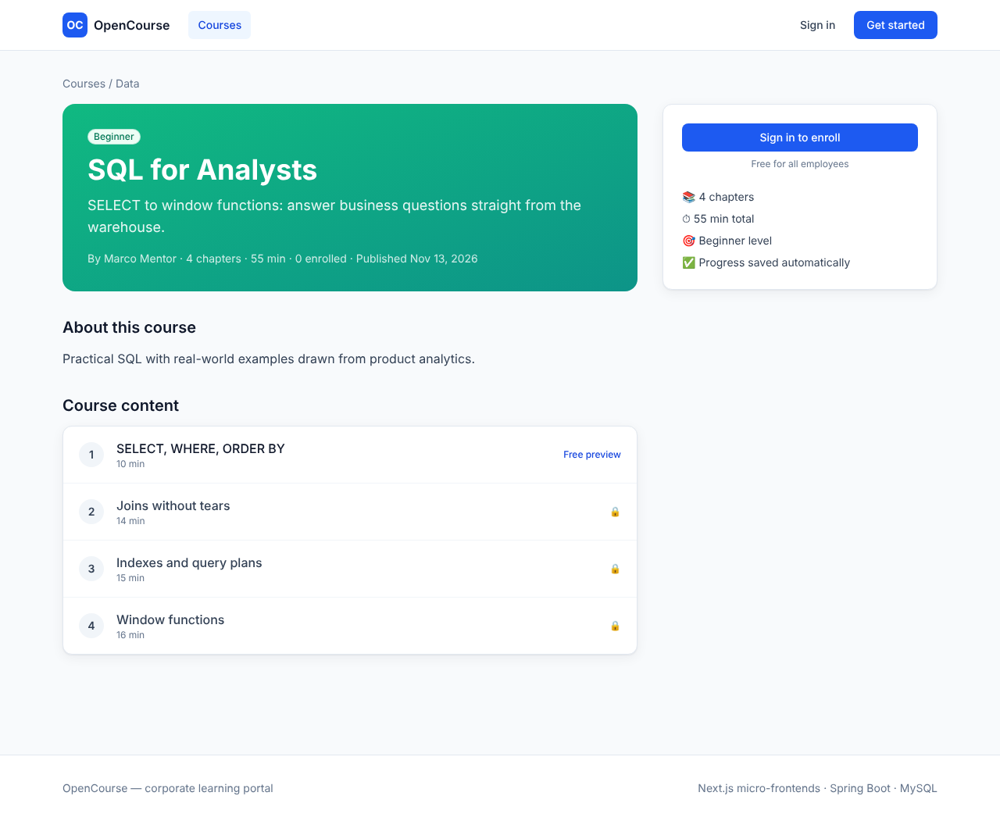
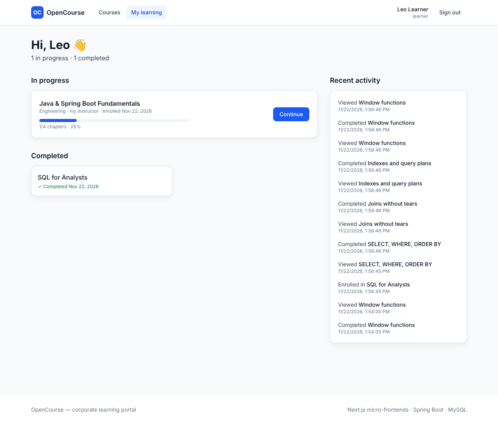
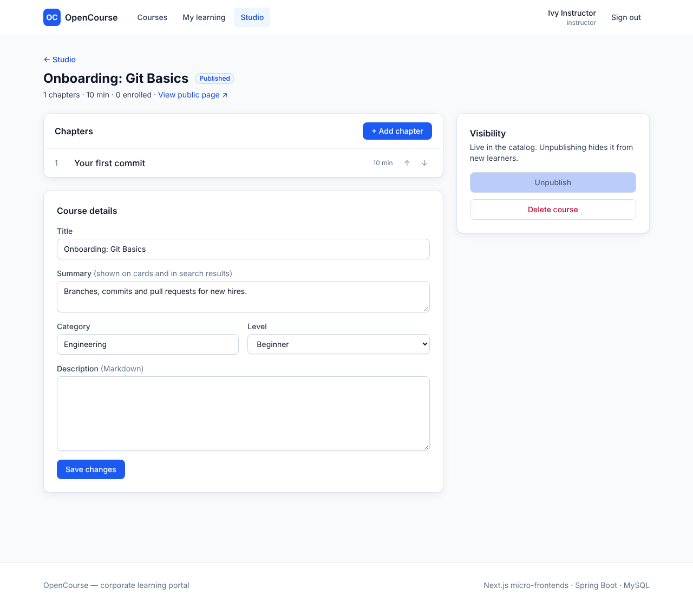
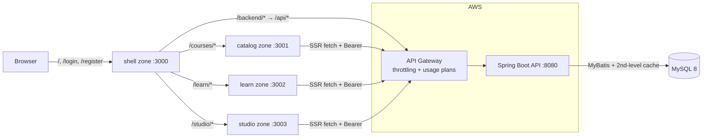

# OpenCourse — Online Course Management System

A full-stack e-learning portal for onboarding and training employees. Learners browse a catalog, enroll, read chapters and track their progress. Instructors write and publish courses in a studio.

- **Frontend:** Next.js 15 (App Router, SSR), React 19, Tailwind CSS. Split into **micro-frontends** using Next.js multi-zones.
- **Backend:** Java 17, Spring Boot 3.5, MyBatis, MySQL 8. Stateless JWT auth.
- **Infra:** AWS API Gateway throttling and rate limiting (Terraform), Docker Compose, GitHub Actions CI.

| Course page (SSR + JSON-LD) | Learner dashboard | Studio |
|---|---|---|
|  |  |  |

> This repository is a 2026 rebuild of a project I first built in 2025, rewritten from scratch.

---

## Architecture



| Zone | Path | Responsibility |
|---|---|---|
| `shell` | `/`, `/login`, `/register`, `sitemap.xml` | Home page, auth, and reverse proxy that stitches the zones together |
| `catalog` | `/courses/*` | SEO-critical public pages: search, filters, course detail with JSON-LD |
| `learn` | `/learn/*` | Learner dashboard, chapter reader, progress tracking |
| `studio` | `/studio/*` | Course and chapter authoring for instructors and admins |

Each zone is a separate Next.js app. You can build and deploy each one on its own, and a broken studio build can't take down the catalog. All four share `packages/shared`: types, API clients, Tailwind preset and UI components, so the product still looks like one app.

**Auth flow.** Login returns a JWT in the response body and also sets it as an `httpOnly`, `SameSite=Lax` cookie. Browser calls go through the shell's same-origin `/backend/*` rewrite, so page JavaScript never touches the token. During SSR, each zone reads the cookie and forwards it as a `Bearer` header.

---

## Features

**Learners:** full-text search, category and level filters, pagination, free preview chapters, one-click enroll, a Markdown chapter reader with prev/next navigation, "mark complete & continue", per-course progress bars, and a recent-activity feed.

**Instructors:** create and edit courses, add/edit/delete/reorder chapters, write Markdown with live preview, publish and unpublish (publishing requires at least one chapter). Instructors can only edit their own courses. Admins can edit all of them.

**Platform:** role-based access (`LEARNER`, `INSTRUCTOR`, `ADMIN`), drafts that stay invisible to the public, validation errors returned per field, and a consistent JSON error format.

---

## Backend highlights

### REST API

| Method | Path | Auth | Description |
|---|---|---|---|
| POST | `/api/auth/register` · `/login` · `/logout` | – | Stateless JWT auth (body and httpOnly cookie) |
| GET | `/api/auth/me` | user | Current user |
| GET | `/api/courses?q=&category=&level=&page=&size=` | – | Published catalog, paginated |
| GET | `/api/courses/categories` · `/sitemap` | – | Facets and sitemap feed |
| GET | `/api/courses/{slug}` | optional | Course, chapter outline, viewer state (enrolled, progress, canEdit) |
| POST / DELETE | `/api/courses/{id}/enroll` | user | Enroll (idempotent) or unenroll |
| GET | `/api/chapters/{id}` | optional | Chapter content (preview chapters are public, others need enrollment) |
| POST | `/api/chapters/{id}/complete` | user | Mark complete. Completes the course when every chapter is done |
| GET | `/api/me/enrollments` · `/api/me/activity` | user | Dashboard data |
| GET / POST / PUT / DELETE | `/api/studio/courses[/{id}]` | instructor | Course CRUD |
| POST | `/api/studio/courses/{id}/publish` · `/unpublish` | instructor | Visibility |
| POST / PUT / DELETE | `/api/studio/courses/{id}/chapters`, `/api/studio/chapters/{id}` | instructor | Chapter CRUD |
| PUT | `/api/studio/courses/{id}/chapters/order` | instructor | Reorder chapters (transactional) |

### Database design and indexing

Schema: [`backend/src/main/resources/db/schema.sql`](backend/src/main/resources/db/schema.sql). Six InnoDB tables: `users`, `courses`, `chapters`, `enrollments`, `chapter_progress`, `user_activity`.

Each B-tree index was chosen for a specific query:

| Index | Serves |
|---|---|
| `user_activity (user_id, created_at)` | "Latest N events for a user". MySQL does an index range scan in order, with no filesort |
| `enrollments UNIQUE (user_id, course_id)` | "My courses" lookups by user, and enforces one enrollment per course |
| `chapter_progress PK (user_id, chapter_id)` + `(user_id, course_id)` | Idempotent completion (`INSERT IGNORE`) and per-course progress counts |
| `courses (status, published_at)`, `(category, status)` | Catalog listing and category filters |
| `chapters (course_id, position)` | Ordered course outline |

**Measured.** [`scripts/benchmark_indexes.py`](scripts/benchmark_indexes.py) fills a copy of `user_activity` with **1,000,000 rows / 5,000 users** and times the exact activity-feed query from `ActivityMapper.xml` (MySQL 8.0, default config, run on a dev container):

| | Plan | Mean | p95 |
|---|---|---|---|
| No index | `type=ALL`, `Using filesort`, ~1M rows examined | 176.8 ms | 192.6 ms |
| `(user_id, created_at)` | `type=ref`, backward index scan, ~200 rows | 0.37 ms | 0.50 ms |

### Caching

The catalog is read-heavy, so `CourseMapper` uses **MyBatis' second-level cache** (LRU, 1024 entries). `ChapterMapper` joins the same cache namespace through `<cache-ref>`, so any course *or* chapter write flushes it, and learners never see a stale chapter count after an edit. An integration test checks this. Per-user data (enrollments, progress, activity) changes on almost every write, so it is deliberately left uncached.

### Rate limiting

- **AWS:** [`infra/terraform`](infra/terraform) puts a REST API Gateway in front of the service. It applies stage-wide token-bucket throttling (50 rps, burst 100), a much stricter limit on `/api/auth/*` (5 rps, burst 10) against credential stuffing, and a usage plan with API keys and a daily quota for server-to-server integrations. Over-limit requests get `429` at the edge.
- **Local:** `RateLimitFilter` is an in-process per-client token bucket configured with the same numbers, so development behaves the same way. It returns `429` with `Retry-After` and `X-RateLimit-*` headers.

### SEO

Catalog pages are server-rendered with per-page `<title>`, meta description, canonical URL and Open Graph tags. Course pages include `schema.org/Course` JSON-LD. The shell serves `sitemap.xml`, built from `/api/courses/sitemap`, and a `robots.txt` that keeps private zones out of search indexes.

---

## Running it

### Option A: everything in Docker

```bash
docker compose up --build
# open http://localhost:3000
```

### Option B: dev mode

```bash
# 1. MySQL
docker compose up -d mysql

# 2. API (creates the schema and seeds demo data on startup)
cd backend && mvn spring-boot:run

# 3. All four zones with hot reload
cd frontend && npm install && npm run dev
# open http://localhost:3000
```

**Demo accounts** (password `password123`): `learner@demo.dev`, `instructor@demo.dev`, `mentor@demo.dev` (second instructor), `admin@demo.dev`.

### Configuration

| Variable | Default | Purpose |
|---|---|---|
| `DB_URL` / `DB_USER` / `DB_PASSWORD` | local `ocs` DB | MySQL connection |
| `OCS_JWT_SECRET` | dev value | HMAC key, **at least 32 bytes**. Always set it in production |
| `OCS_COOKIE_SECURE` | `false` | Set `true` behind HTTPS |
| `OCS_RATE_LIMIT_*` | on, 100 burst / 50 rps | In-process limiter |
| `OCS_CORS_ORIGINS` | `http://localhost:3000` | Front-end origins allowed for CORS and for cookie-authenticated writes (CSRF check) |
| `FORWARD_HEADERS_STRATEGY` | `none` | Set `framework` only behind a trusted proxy/ALB, so the rate limiter sees real client IPs |
| `DB_INIT_MODE` | `always` | Set `never` once migrations own the schema |
| `BACKEND_URL` (frontend) | `http://localhost:8080` | API origin used by SSR and the shell proxy |
| `CATALOG_URL` / `LEARN_URL` / `STUDIO_URL` | `localhost:3001-3003` | Zone origins (shell, resolved at build time) |
| `SITE_URL` | `http://localhost:3000` | Canonical URLs and sitemap |

---

## Tests

```bash
cd backend
mvn test                                   # unit tests (JWT, rate limiter, slugs)
DB_URL='jdbc:mysql://localhost:3306/ocs?useSSL=false&allowPublicKeyRetrieval=true&connectionTimeZone=UTC&forceConnectionTimeZoneToSession=true' mvn test
                                           # + end-to-end API tests against real MySQL
```

`ApiIntegrationTest` drives the whole API through MockMvc against a real database:
- catalog paging and search, with drafts hidden from the public
- the learner path: preview → 401/403 on locked chapters → enroll (idempotent) → read → complete every chapter → course marked completed → activity feed → unenroll
- the instructor path: create → publishing blocked with no chapters → add chapters → publish → cache invalidation → reorder → another instructor gets 403 → delete
- validation errors and bad credentials

CI (`.github/workflows/ci.yml`) runs the backend tests against a MySQL service container, type-checks and builds all four frontend zones, and validates the Terraform.

---

## Project layout

```
backend/                 Spring Boot API
  src/main/java/com/bohuai/ocs/
    controller/          REST controllers (auth, catalog, learning, studio)
    service/             business rules, authorization, transactions
    mapper/ + resources/mapper/*.xml   MyBatis SQL
    security/            JWT, auth filter, roles
    config/              rate limiter, CORS, properties
  src/main/resources/db/ schema.sql, data.sql (generated by scripts/gen_seed.py)
frontend/                npm workspaces
  apps/shell|catalog|learn|studio   Next.js zones
  packages/shared        types, API clients, UI components, Tailwind preset
infra/terraform/         API Gateway + throttling + usage plans
scripts/                 seed generator, index benchmark
```
