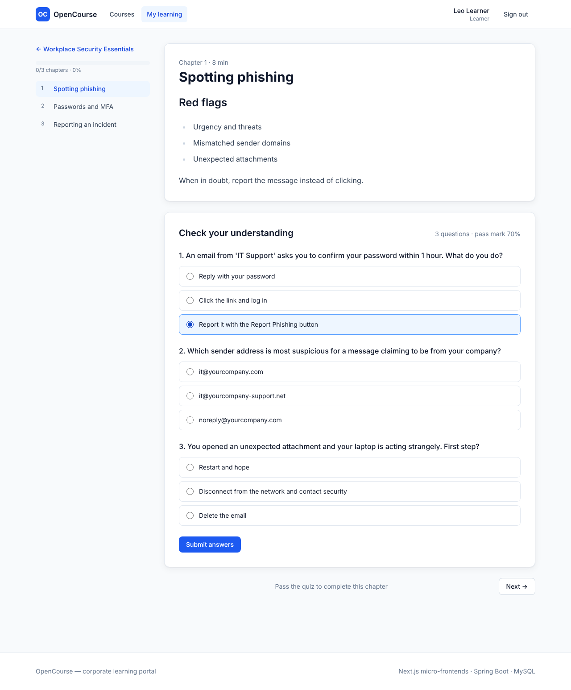
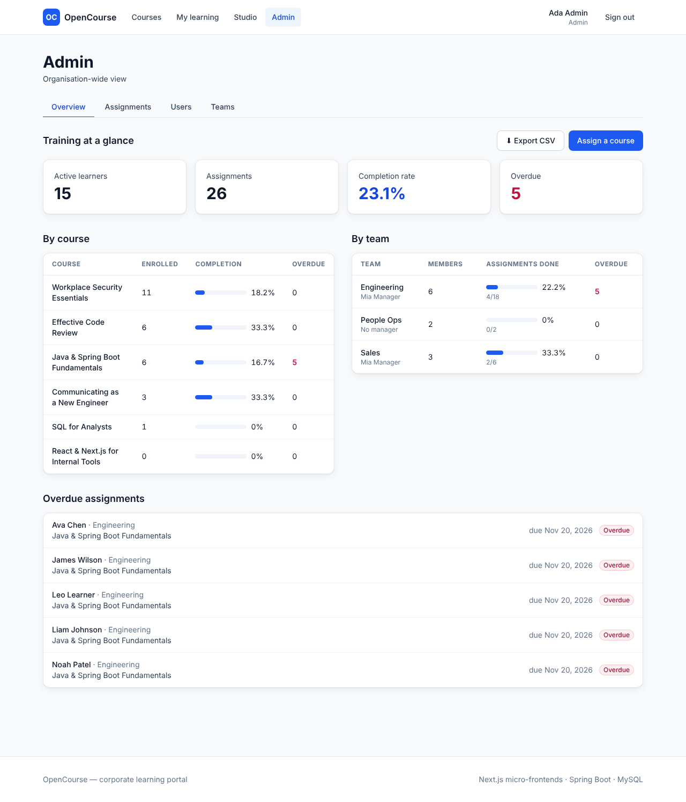
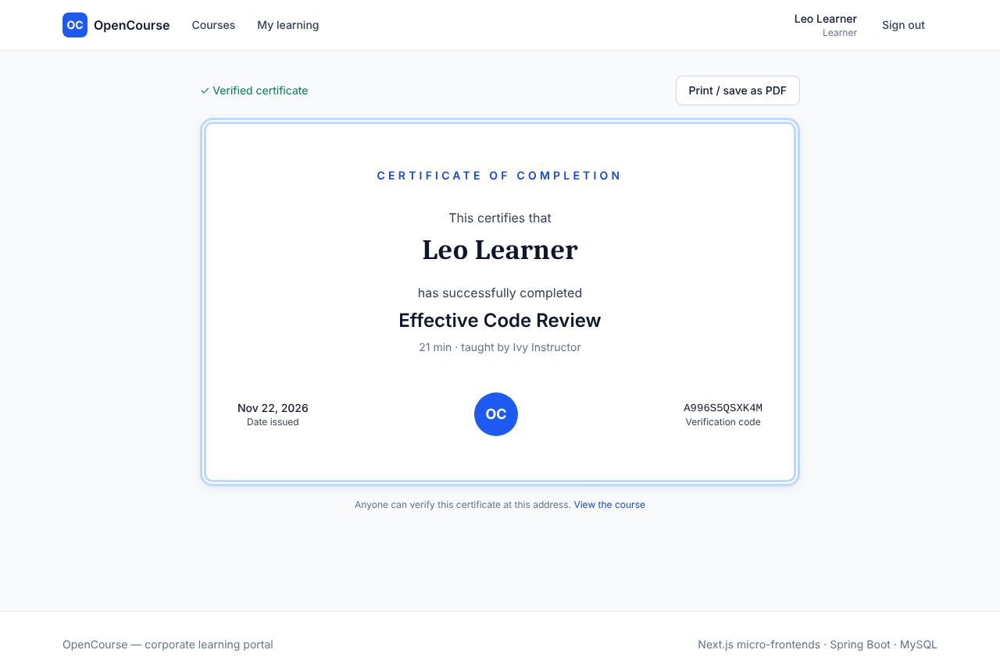
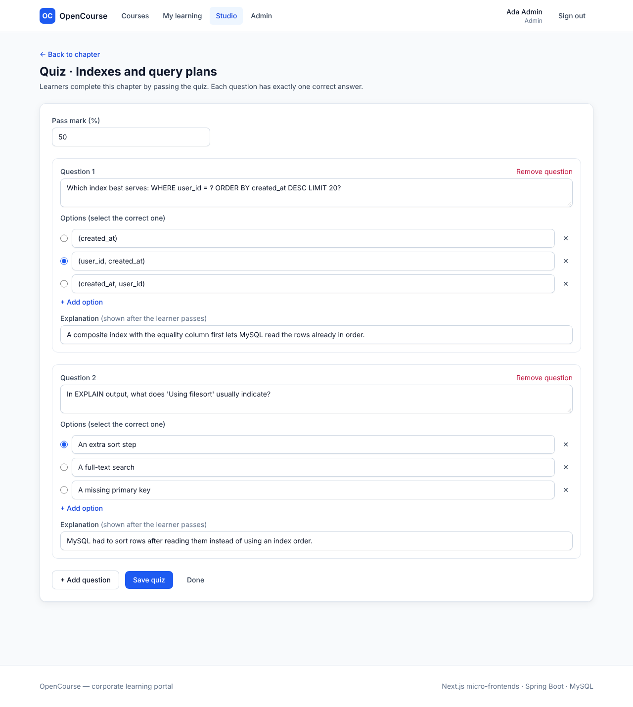
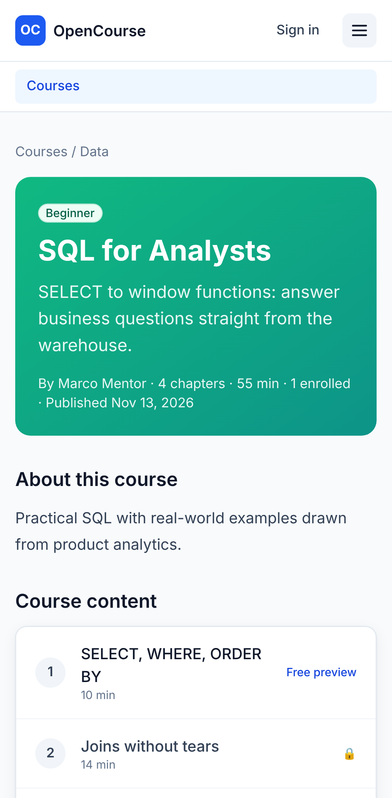
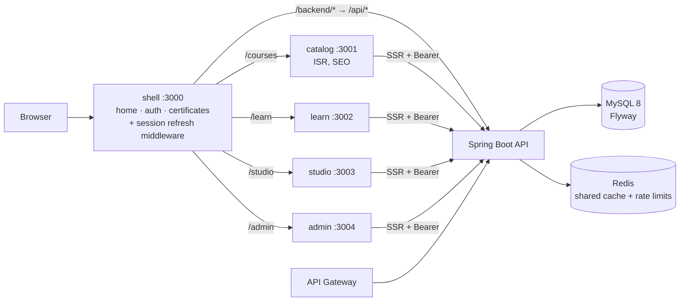

# OpenCourse — Online Course Management System

A corporate e-learning platform. Employees take courses with video, quizzes and certificates. Managers assign training with due dates and track their teams. Instructors write courses in a studio. Admins manage users and teams.

[](https://github.com/BohuaiSong2004/online-course-system/actions/workflows/ci.yml)

| Learner dashboard | Chapter quiz | Manager / admin reports |
|---|---|---|
|  |  |  |

| Course page (static, SEO) | Verifiable certificate | Quiz editor | Phone |
|---|---|---|---|
|  |  |  |  |

> This repository is a 2026 rebuild of a project I first built in 2025, rewritten from scratch.

**Stack:** Next.js 15 micro-frontends (five zones) · React 19 · Tailwind · Spring Boot 3.5 · MyBatis · MySQL 8 · Redis · Flyway · JWT (jjwt) · Playwright · Terraform on AWS (ECS Fargate, RDS, ElastiCache, ALB, API Gateway).

**Measured** (details and method in [`docs/performance.md`](docs/performance.md)):
- A composite B-tree index takes the activity feed from **176.8 ms → 0.37 ms** on 1M rows.
- The MyBatis cache gives **~3× catalog throughput** under load (600 → 1,700–2,000 req/s on 2 vCPUs).
- **200 concurrent learners** enrolling and completing the same course: 0 errors, 100% consistency checks passed.
- Lighthouse on public pages: **99 / 100 / 100 / 100** (performance, accessibility, best practices, SEO).
- **39 backend tests** (90.6% line coverage) and **21 browser tests**, including WCAG 2.1 AA scans, all in CI.

---

## Features

| Role | Can do |
|---|---|
| **Learner** | Search the catalog (full-text), take free preview chapters, enroll, watch embedded video, read Markdown lessons, pass chapter quizzes, track progress, see assigned courses with due dates and overdue alerts, earn and print certificates, view their activity feed, edit their profile and password |
| **Instructor** | Create and edit courses, add, reorder and delete chapters, attach a video, write a quiz (single answer, configurable pass mark), publish and unpublish |
| **Manager** | See completion reports for the teams they manage, assign courses to a whole team or chosen people with a due date, filter assignments by status, export CSV |
| **Admin** | Everything above, organisation-wide, plus user management (role, team, deactivate) and team management |

Anyone can check a certificate on a public page using its 12-character code.

## Architecture



- **Micro-frontends.** Each zone is a separate Next.js app (Next multi-zones), built and deployed on its own. They share types, API clients and UI through `frontend/packages/shared`. The shell proxies the other zones, so the browser only ever sees one origin.
- **Rendering.** Public pages are statically generated and revalidated (ISR): the home page every 60 s, course pages pre-generated with JSON-LD, canonical URLs and Open Graph tags, plus a sitemap. Signed-in pages are server-rendered with the user's session. Personal state on public pages loads in the browser, so the cached HTML is the same for everyone.
- **Sessions.**
  - The access token is a 15-minute JWT. The refresh token is a random 256-bit value, stored only as a hash and rotated on every use.
  - Reusing an already-rotated refresh token revokes all of that user's sessions. A 10 s grace window absorbs a browser's own parallel requests.
  - Both tokens live in httpOnly, SameSite=Lax cookies. Cookie-authenticated writes from other sites are refused by an Origin check.
  - The shell middleware refreshes sessions for every zone. The browser client refreshes once on a 401 and retries.
  - Logout, a password change or an admin role change revokes refresh tokens.
- **Caching.** The MyBatis second-level cache covers the read-heavy catalog. Chapter and quiz mappers share its namespace, so any edit invalidates everything that depends on it. With `OCS_REDIS_ENABLED=true` the cache moves to Redis and is shared by all API instances. Deserialization is restricted to the app's model classes and JDK types.
- **Rate limiting.** A token bucket per client. It runs in-process for a single instance, or as an atomic Redis Lua script (on the Redis clock) for a cluster. AWS API Gateway applies stage, auth-endpoint and API-key usage-plan limits at the edge.
- **Observability.** OpenAPI and Swagger UI, Prometheus metrics (including learning-event and rate-limit counters), an `X-Request-Id` on every log line, and optional JSON logs.

## Data model and indexing

Flyway migrations live in [`backend/src/main/resources/db/migration`](backend/src/main/resources/db/migration). Demo data is a separate one-time migration.

| Table | Purpose / key indexes |
|---|---|
| `users`, `teams` | Roles LEARNER, MANAGER, INSTRUCTOR, ADMIN. A team has an optional manager |
| `courses`, `chapters` | `FULLTEXT(title, summary, description)` for search. `(status, published_at)` and `(course_id, position)` for listing and outlines |
| `enrollments` | `UNIQUE(user_id, course_id)` keeps enrollment idempotent and serves "my courses" |
| `chapter_progress` | `PK(user_id, chapter_id)` makes completion idempotent (`INSERT IGNORE`) |
| `assignments` | `UNIQUE(user_id, course_id)`, `due_date` index. Status (completed, overdue, in progress, not started) is derived when read |
| `quiz_questions`, `quiz_options`, `quiz_attempts` | Graded on the server. The answer key is never sent before a pass |
| `certificates` | `UNIQUE(code)`, `UNIQUE(user_id, course_id)` |
| `refresh_tokens` | SHA-256 hash only, `replaced_by` chain for reuse detection |
| `user_activity` | `(user_id, created_at)`: the benchmarked index |

## API

All routes are under `/api`. The full interactive reference is at **`/swagger-ui.html`** once the API is running.

| Area | Endpoints |
|---|---|
| Auth | `POST /auth/register` · `/login` · `/refresh` · `/logout`, `GET /auth/me` · `/auth/session`, `PUT /me/password` · `/me/profile` |
| Catalog | `GET /courses?q=&category=&level=&page=` · `/courses/{slug}` · `/courses/categories` · `/courses/sitemap` |
| Learning | `POST·DELETE /courses/{id}/enroll`, `GET /chapters/{id}`, `POST /chapters/{id}/complete` · `/chapters/{id}/quiz/attempts`, `GET /me/enrollments` · `/me/activity` · `/me/certificates`, `GET /certificates/{code}` (public) |
| Studio | CRUD `/studio/courses`, publish and unpublish, chapters CRUD and reorder, `GET·PUT /studio/chapters/{id}/quiz` |
| Admin | `GET·PUT /admin/users`, CRUD `/admin/teams`, `GET /admin/teams/{id}/members`, `POST·GET·DELETE /admin/assignments`, `GET /admin/reports/overview` · `/admin/reports/assignments.csv` |

## Run it

Requirements: Docker (for the one-command setup), or JDK 17+, Maven 3.9+ and Node.js 22 for dev mode.

**Everything in Docker:**

```bash
docker compose up --build        # MySQL, Redis, API, five zones → http://localhost:3000
```

**Dev mode:**

```bash
docker compose up -d mysql redis
cd backend && mvn spring-boot:run                    # Flyway creates the schema and demo data
cd frontend && npm install && npm run dev            # five zones with hot reload → http://localhost:3000
```

**Demo accounts** (password `password123`):

| Email | Role |
|---|---|
| `learner@demo.dev` | Learner on the Engineering team (has an overdue assignment) |
| `manager@demo.dev` | Manager of Engineering and Sales |
| `instructor@demo.dev` / `mentor@demo.dev` | Instructors |
| `admin@demo.dev` | Admin |

### Configuration

| Variable | Default | Purpose |
|---|---|---|
| `DB_URL` / `DB_USER` / `DB_PASSWORD` | local `ocs` | MySQL (keep `connectionTimeZone=UTC&forceConnectionTimeZoneToSession=true`) |
| `OCS_JWT_SECRET` | dev value | HMAC key, at least 32 bytes |
| `OCS_ACCESS_TTL` / `OCS_REFRESH_TTL` / `OCS_REFRESH_GRACE` | 900 / 1209600 / 10 s | Session lifetimes |
| `OCS_COOKIE_SECURE` | `false` | Set `true` behind HTTPS (API and frontend) |
| `OCS_CORS_ORIGINS` | `http://localhost:3000` | CORS and the cookie-write Origin check |
| `OCS_REDIS_ENABLED`, `REDIS_HOST` / `REDIS_PORT` / `REDIS_SSL` | `false` | Shared cache and rate limits (required for more than one API instance) |
| `OCS_RATE_LIMIT_*` | on, burst 100, 50/s | In-app limiter |
| `FORWARD_HEADERS_STRATEGY` | `none` | `framework` behind a trusted load balancer |
| `OCS_FLYWAY_LOCATIONS` | schema + demo | `classpath:db/migration` in real environments |
| `LOGGING_STRUCTURED_FORMAT_CONSOLE` | — | `ecs` for JSON logs |
| `BACKEND_URL`, `SITE_URL`, `CATALOG_URL` … `ADMIN_URL` | localhost | Frontend origins (shell rewrites resolve at build time) |

## Quality

```bash
cd backend && DB_URL=... REDIS_HOST=localhost mvn verify    # 39 tests + JaCoCo report (target/site/jacoco)
cd frontend && npm run lint && npm run build                 # ESLint (incl. jsx-a11y) + type-check + build
cd e2e && npm ci && npx playwright test                      # 21 browser tests against a running stack
```

CI ([`.github/workflows/ci.yml`](.github/workflows/ci.yml)) runs backend tests against MySQL and Redis containers with a coverage summary, frontend lint and build, the full Playwright suite against a stack it boots itself, Terraform `fmt` and `validate`, and Docker builds of all six images.

Performance scripts: [`perf/`](perf) (k6 load tests, Lighthouse) and [`scripts/benchmark_indexes.py`](scripts/benchmark_indexes.py). Results are in [`docs/performance.md`](docs/performance.md).

## Deploying to AWS

[`infra/`](infra) has a complete Terraform stack: VPC, ECS Fargate with Service Connect, RDS MySQL, ElastiCache Redis, ALB, ECR, Secrets Manager, CPU autoscaling and API Gateway. There is also a manual **Deploy** workflow that uses GitHub OIDC. See [`infra/README.md`](infra/README.md).

## Project layout

```
backend/        Spring Boot API: controller · service · mapper (+ XML) · security · cache · ratelimit · observability
                resources/db/migration (Flyway), resources/db/demo (seed, generated by scripts/gen_seed.py)
frontend/       npm workspaces: apps/{shell,catalog,learn,studio,admin}, packages/shared, eslint.config.mjs
e2e/            Playwright + axe-core suite
infra/          Terraform (AWS) and deployment guide
perf/           k6 scenarios, Lighthouse script
scripts/        seed generator, index benchmark, screenshot capture
docs/           performance results, screenshots
```
